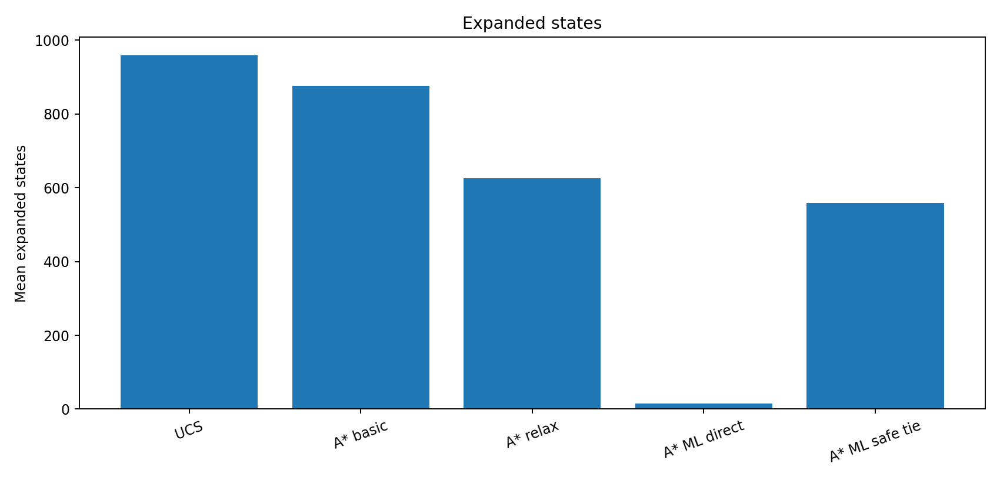
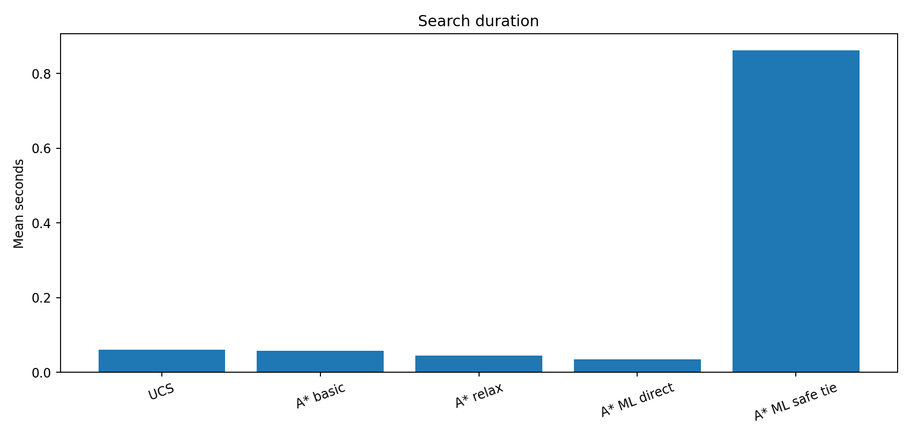
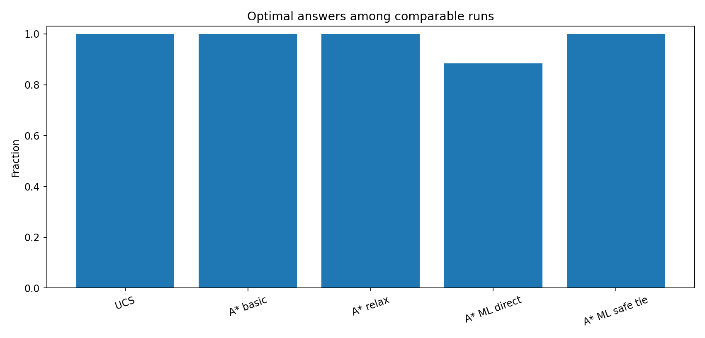

# گزارش آزمایش Heuristic و Machine Learning — مسئله شن

## ۱. مبنای مسئله

- نسخه مدل: `continuous-flow-v2-full-is-1`.
- قرارداد خانه‌ها: `1=پر`، `0.5=نیمه‌پر` و `0=خالی`.
- هدف: تخلیه کامل شبکه با کمینه کردن مجموع هزینه اعمال.
- Greedy استاد، تخلیه ستون‌به‌ستون و فقط با دریچه‌های عمودی است؛ Greedy Best-First Search نیست.
- مثال استاد: هزینه Greedy برابر ۴۷ با ۷ عمل و هزینه بهینه UCS/A* برابر ۳۴.

## ۲. طراحی Heuristic مبتنی بر Relaxation

\[ h_{\mathrm{relax}}(s)=E(s)+\sum_{r=1}^{R-1}L_r(s) \]

در این تعریف، \(E(s)\) حداقل هزینه خروج شن از پایین شبکه است: برای نیم‌واحد باقی‌مانده ۳، برای مقدار بیشتر ۵ و برای هدف صفر. هر مرز ردیفی با شن بالای آن، اگر هیچ دریچه عمودی بازی نداشته باشد حداقل سهم ۳ (نیم‌واحد) یا ۵ (حداقل یک واحد) دارد. در غیر این صورت سهمش صفر است.

**دلیل مجاز بودن:** برای تخلیه کامل، شن بالای هر مرز ناچار است از آن عبور کند. اگر آن مرز دریچه عمودی باز ندارد، دست‌کم یک باز کردن دریچه لازم است؛ در تخمین، ارزان‌ترین هزینه اجتناب‌ناپذیر آن عمل را در نظر می‌گیریم. عمل باز کردن دریچه هر مرز از اعمال مرزهای دیگر و اعمال خروجی جداست. هزینه حرکت افقی و باز کردن‌های اضافه را حذف می‌کنیم. ازاین‌رو، طبق قوانین هزینه نسخه فعلی مدل، مجموع این کران‌ها از هزینه بهینه بیشتر نمی‌شود. این استدلال باید با فرض جریان پیوسته همین مدل خوانده شود.

روی مدل ۳×۲، Admissibility و Consistency با آزمون جامع وضعیت‌های پایدار بررسی می‌شوند. آزمون محدود، جای اثبات برای همه ابعاد شبکه نیست.

## ۳. آموزش یادگیری ماشین

هدف رگرسیون، پیش‌بینی \(h^*(s)\) یعنی هزینه بهینه باقی‌مانده است. برچسب‌ها از Reverse Dijkstra روی تمام وضعیت‌های پایدار ۳×۲ استخراج شدند. ویژگی‌ها عبارت‌اند از: اشغال هر خانه، بیت دریچه‌های باز، مجموع شن هر ردیف و مجموع شن شبکه. مدل RandomForestRegressor استفاده شد.

آرایش‌های شن با GroupShuffleSplit به آموزش و آزمون تقسیم شدند؛ همه ماسک‌های دریچه متعلق به یک آرایش شن در یک گروه هستند.

| Seed آموزش | Train states | Test states | MAE | RMSE | R² | درصد بیش‌برآورد |
|---:|---:|---:|---:|---:|---:|---:|
| 42 | 8939 | 2303 | 0.9728 | 1.2363 | 0.9577 | 37.13٪ |
| 43 | 8907 | 2335 | 0.9260 | 1.1721 | 0.9632 | 56.49٪ |
| 44 | 8090 | 3152 | 1.1701 | 1.5716 | 0.9389 | 42.70٪ |

**محدودیت داده:** وضعیت اولیه هر آزمایش از آرایش‌های آزمون انتخاب شده، اما حالت‌های میانی که طی جست‌وجو ایجاد می‌شوند ممکن است از آرایش‌های موجود در آموزش باشند. پس این آزمایش تعمیم روی ورودی اولیه ندیده را می‌سنجد، نه لزوماً روی تک‌تک حالت‌های میانی ندیده.

## ۴. طراحی مقایسه جست‌وجو

- Seedهای مستقل آموزش/تقسیم: `42, 43, 44`.
- حداکثر 20 شبکه اولیه آزمون برای هر Seed، 1 تکرار برای هر شبکه و روش.
- محدودیت اجرا: 20 ثانیه و 100,000 گسترش.
- بارگذاری مدل و زمان آموزش خارج از زمان جست‌وجو هستند؛ پیش‌بینی ML در زمان جست‌وجو حساب می‌شود.
- پیش‌بینی‌های تکراری در یک جست‌وجو کش و پیش‌بینی وضعیت‌های جدید در هر گسترش دسته‌ای محاسبه می‌شود. کش بین اجراهای مستقل منتقل نمی‌شود.
- UCS مرجع هزینه بهینه است؛ برای مسئله‌های Timeout شکاف هزینه ثبت نمی‌شود.
- ML Direct بهینگی تضمین‌شده ندارد؛ ML Safe Tie از g+h_relax به‌عنوان کلید اصلی و ML فقط برای شکستن تساوی استفاده می‌کند.

## ۵. نتایج تجمیعی

| روش | اجرا | حل‌شده | بهینه / قابل‌مقایسه | میانگین Expanded | میانگین زمان (ثانیه) | میانگین شکاف هزینه |
|---|---:|---:|---:|---:|---:|---:|
| UCS | 60 | 60 | 60/60 | 959.78 | 0.060214 | 0.000 |
| A* basic | 60 | 60 | 60/60 | 876.88 | 0.057493 | 0.000 |
| A* relax | 60 | 60 | 60/60 | 626.53 | 0.045140 | 0.000 |
| A* ML direct | 60 | 60 | 53/60 | 14.78 | 0.034472 | 0.117 |
| A* ML safe tie | 60 | 60 | 60/60 | 559.15 | 0.862823 | 0.000 |

برای تفسیر میانگین زمان، علاوه بر `summary_all_seeds.csv` می‌توان نتایج هر Seed را در `summary_by_seed.csv` مشاهده کرد. زمان اجرا تحت تأثیر سخت‌افزار، بار سیستم و سربار استنتاج ML است.

## ۶. تحلیل و نتیجه

- Relaxation نسبت به Basic در این مجموعه آزمایش 28.5٪ حالت کمتر گسترش داده است.
- ML Direct در 53 مورد از 60 اجرای قابل‌مقایسه هزینه بهینه را پیدا کرده است؛ این نسبت یک تضمین نظری برای مدل یادگیری نیست.
- ML Safe Tie در 60 مورد از 60 اجرای قابل‌مقایسه به هزینه UCS رسیده است؛ تضمین نظری آن از Heuristic Relaxation و استفاده از ML صرفاً در شکستن تساوی‌ها ناشی می‌شود.
- نتایج شبکه ۳×۲، برای شبکه‌های بزرگ‌تر بدون آموزش و آزمون جدا قابل تعمیم قطعی نیستند.
- اگر حافظه اندازه‌گیری نشده باشد، نباید برای آن عدد در گزارش نوشت.

## ۷. فایل‌های بازتولید آزمایش

- `training_metrics.csv`: کیفیت رگرسیون برای Seedهای مختلف.
- `comparison_all_seeds.csv`: تمام اجراهای جست‌وجو.
- `summary_all_seeds.csv` و `summary_by_seed.csv`: خلاصه نتایج.
- `seed_*/training/dataset_split.json`: فهرست گروه‌های آموزش و آزمون.
- `seed_*/comparison/experiment.json`: تنظیمات هر مقایسه.
